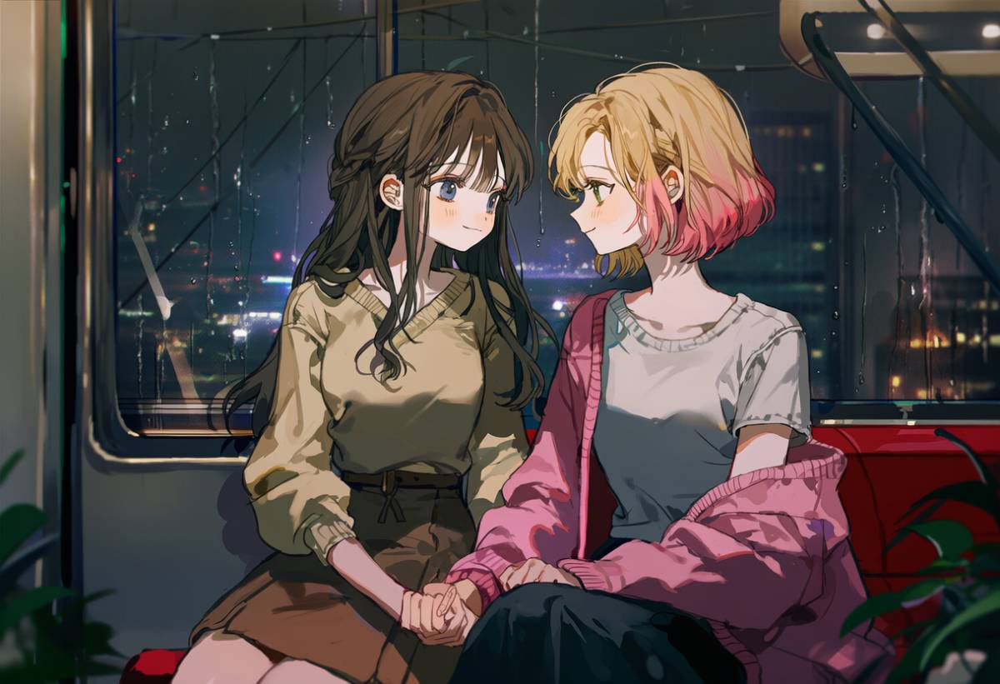
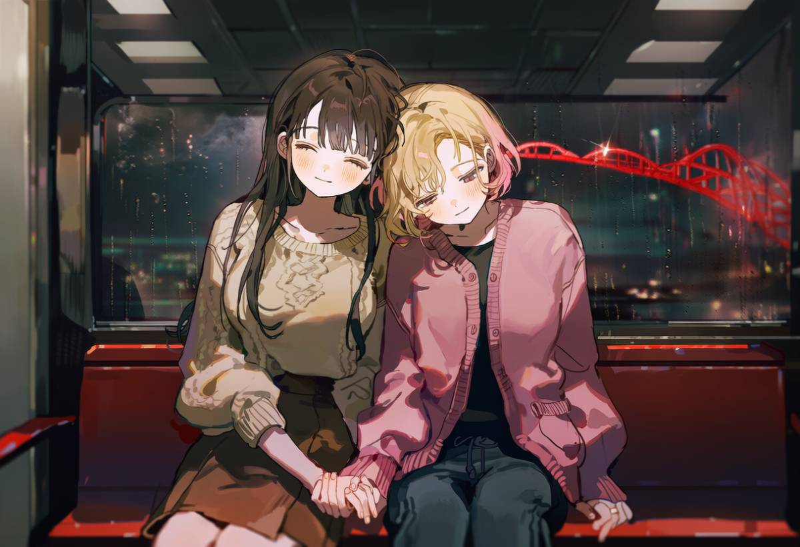
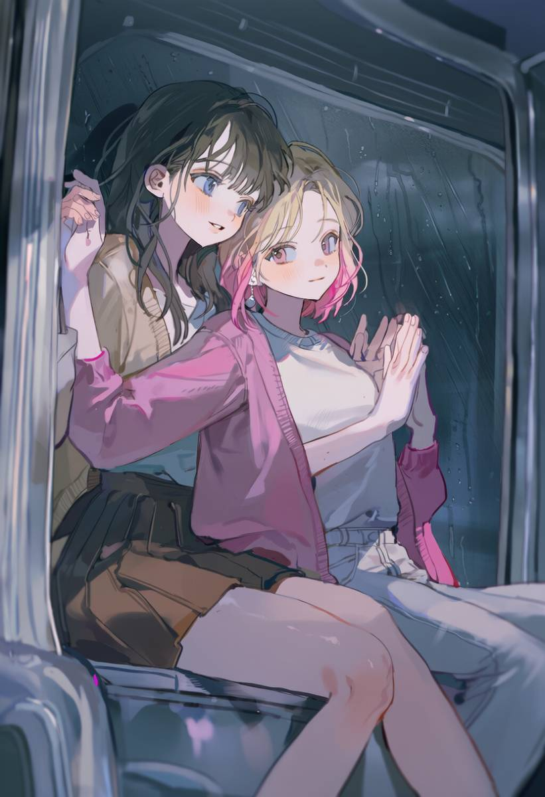
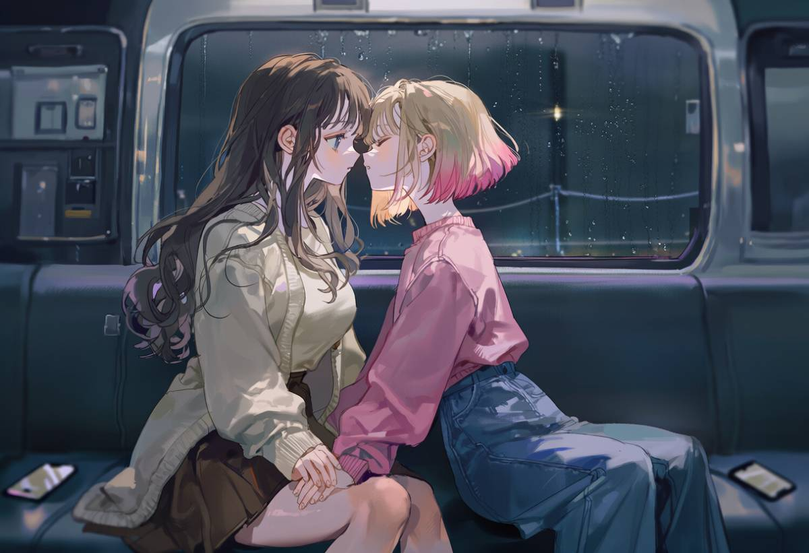

ATTG 오푸스 5.5

여수 밤바다

Seyon × Soyu

SITUATION

이 바다를 너와 함께 걷고 싶어.

  

    
오후 6시 10분, 우리는 돌산도에서 여수 해상 케이블카를 타기 위해 택시를 탔다. 우산이 필요할 정도로 가랑비가 꾸준히 내리는 밤, 우리는 지도에는 공원이라고 적혀 있지만 산처럼 높이 솟아 있는 매표소에 도착했다. 크리스탈 캐빈 대신 일반 캐빈을 선택했고, 새빨간 케이블카가 우리를 맞이하자 조심스럽게 올라탔다. 그러고는 앞을 바라보며 나란히 앉았다. 케이블카가 천천히 올라가기 시작했다.

      
"비가 오는데도 케이블카가 운행해서 너무 다행이다~ 가랑비가 내리니까 분위기가 더 있는 것 같아."

    
키득거리며 바라보니 바로 곁에 세연이의 뺨이 보여 쪽 입을 맞추었고, 그러고는 아기 새가 모이를 쪼아대듯 몇 번 더 쪽쪽 입을 맞췄다. "난 산에서 온 아기 새야. 우아한 아가씨한테 뽀뽀하는 습관이 있지!"

    
내 엉뚱한 소리에 쿡쿡 웃으며, 나는 세연이의 손을 부드럽게 잡았다. 자연스럽게 세연이에게 기대며, 세연이가 궁금해할 것 같을 때마다 "바다 위로 배들이 지나가고 있어,"라거나 "케이블카에 맺힌 빗방울 때문에 밖의 불빛들이 훨씬 더 번져 보여." 같은 이야기들을 들려주었다. 그 외에는 나 역시 눈을 반쯤 감은 채, 케이블카가 부드럽게 올라가는 느낌과 어둠 속에서 한층 더 쏟아져 내리는 듯한 불빛들, 그리고 쌀쌀한 공기 속에서 훨씬 더 가깝게 느껴지는 세연이의 온기와 향기를 그저 온몸으로 느꼈다.

      
"너무 좋다. …음~ 이 순간이 정말 좋아."

  

  

    
<form class="vn-form">
  

    <input type="radio" name="vn-route" class="vn-hidden-input route-init" checked>
    

    

    

    
세연

    
세연

    
소유

    <label class="vn-dialogue dialogue-base"><input type="checkbox" class="vn-hidden-input toggle-base">
      

        
2026년 10월 23일 금요일, 오후 6:17

        
세연 : 크림색 블라우스 위에 오트밀 니트 가디건, 부드러운 갈색 플리츠 스커트, 낮은 갈색 구두 / 소유 : 연분홍 가디건, 흰색 티셔츠, 와이드 베이지 팬츠, 흰색 스니커즈

      

    </label>
    <label class="vn-dialogue dialogue-route1"><input type="checkbox" class="vn-hidden-input toggle-route1">
      

        
여수 해상 케이블카, 항구 상공, 비로 차가워진 창가에 관자놀이를 대고 소유의 손을 꼭 쥔 채 나란히 앉아 있다.

        
다리는 대부분 붉은 빛이지만, 그녀의 손에는 형태가 있다.

      

    </label>
    <label class="vn-dialogue dialogue-route2"><input type="checkbox" class="vn-hidden-input toggle-route2">
      

        
여수 해상 케이블카, 항구 상공, 앞을 향한 벤치에서 세연에게 기대어 있다.

        
산새에게 내려앉을 자리가 하나 더 주어졌다.

      

    </label>
    <button type="reset" class="vn-reset-btn">❈</button>
    

      <label class="vn-choice-btn"><input type="radio" name="vn-route" class="vn-hidden-input route-1">세연</label>
      <label class="vn-choice-btn"><input type="radio" name="vn-route" class="vn-hidden-input route-2">소유</label>
    

  

</form>

    
가벼운 입맞춤들이 세연의 광대뼈에서부터 귀 근처까지 줄지어 조붓하게 내려앉았다. 네 번째에 이르러서는 입술을 다물고 참아보려던 시도마저 포기했다. 그녀의 웃음소리는 케빈 지붕을 일정하게 두드리는 빗소리와 정류장에서 멀어지게 하는 기계적인 웅웅거림 속에 낮게 파묻혔다.

    
"산새 한 마리가," 볼가에 여전히 머물러 있는 온기를 향해 고개를 돌리며 그녀가 말했다. "우아한 아가씨를 괴롭히겠다는 일념 하나로 빗속을 뚫고 섬까지 날아왔네. 본능이 참 유별나기도 하지."

    
세연은 이어지는 입맞춤을 자신의 입술로 맞받았다. 소유의 입술 위가 아니라, 미소로 봉긋하게 솟아오른 입꼬리 언저리였다. 그러고는 맞잡은 손을 둘의 허벅지 사이에 둔 채 성형 플라스틱 좌석에 다시 몸을 기댔다. 케이블카는 너무나도 매끄럽게 상승해 고도감이 뱃속의 울렁임이 아닌 소리로 먼저 와닿았다. 뒤편에서 잦아드는 매표소의 안내 방송, 저 아래에서 물기를 머금은 채 흩어지는 자동차 타이어 마찰음, 그리고 엔진 소리와 뱃고동, 바닷물 소리가 한데 섞여 한층 넓게 펼쳐지는 항구의 풍경으로.

    
소유의 묘사는 그 넓은 공간 속에 하나씩 또렷한 형상을 채워 넣었다. 바다를 가로지르는 배들. 빗줄기가 빛을 모아 번지게 만드는 모습. 세연은 굳이 모든 건물의 수를 세거나 모든 색깔의 이름을 알 필요가 없었다. 소유는 오래전에 그 사실을 깨달았다. 그녀는 변화하는 사실만을 알려 주었다—지나가는 배, 가까워지는 다리 같은 것들을—그리고 차가운 창문과 케이블 아래로 느껴지는 희미한 흔들림, 빛의 변화가 나머지를 채우도록 내버려 두었다.

    

    
유리창 너머로 빛이 또 다른 빛 속을 유영했다. 항구의 풍경은 대부분 어둠 속에서 고르지 못한 엷은 빛으로만 다가왔지만, 가장 강렬한 불빛들은 그대로 뚫고 들어왔다. 빗방울이 유리창을 타고 흘러내리며 길게 떨리는 번짐, 그리고 작은 흰 점들이 그 아래를 스쳐 지나가는 동안 제자리를 지키고 있는 붉은 수직의 광채. 세연은 고개를 살짝 들었다. 수면 위에서 부서졌다 다시 엉겨 붙기를 거듭하는 넓은 반영이 아래에서 일렁였다.

      
"저게 다리야?"

    
소유의 대답에 세연은 손을 놓지 않은 채 창가 쪽으로 좀 더 다가앉았다. 흩어진 머리카락 틈으로 차가운 유리창이 관자놀이에 닿았다. 저기—이제 붉은빛이 한층 짙어져, 아래쪽의 빛 띠로 연결된 두 개의 곧은 불꽃 형상을 이루고 있었다. 소유가 보는 완전한 형상은 아니었고, 그렇다고 아닌 척 꾸며낼 필요도 없었다. 그것이 다가오는 것을 느끼고, 케이블카와 그것을 갈라놓는 캄캄한 바닷물을 가늠하는 것만으로도 충분했다.

    
"붉은색은 보여," 세연이 말했다. "케이블은 안 보이지만. 주탑인 것 같네—물에 비친 불빛이랑." 엄지손가락으로 소유의 손가락 마디를 한 번 쓸어내렸다. "비가 와서 다행이야. 빛나는 것들이 전부 본래 크기보다 더 커졌거든."

    
케이블카가 지주 타워를 통과했다. 머리 위 가이드 어셈블리에 바퀴가 맞물리며 빠르고 묵직한 마찰음을 냈고, 발밑의 바닥이 잘게 떨렸다. 세연은 본능적으로 어깨를 굳혔지만, 이내 곁에 밀착된 소유의 무게감이 그대로 전해졌고 손안에 든 손도 여전히 따스했다. 참았던 숨을 내쉬며 소유의 머리 꼭대기에 뺨을 얹었다. 블루 오키드 향수 아래로 젖은 안개비 냄새가 맴돌았고, 세연이 움직일 때마다 그녀 자신의 축축해진 가디건에서 수지 살몬의 잔향이 피어올랐다.

    
"좋다," 세연이 나직이 맞장구쳤다. 빗소리에 묻힐 듯 소유보다 한결 잦아든 목소리였다. 잠시 귀를 기울이던 그녀가 덧붙였다. "무언가 움직이기 시작하면 말해 주고, 그러고 나선 다시 조용해지는 게 참 좋아. 내가 이곳을 함께 느낄 틈을 주니까."

    

    
세연의 손가락이 소유의 손을 감싸 쥐었다. 다잡으려는 것이 아닌, 그저 전해져 온 힘에 대한 화답이었다. 두 사람의 모습은 검은 바다 위에 떠 있는 붉은 벤치에 앉은 두 여인으로 정면 유리창 어딘가에 비치고 있을 터였다. 세연은 그 유리에 비친 상을 눈으로 확인할 수는 없었지만, 물리적인 감각으로 분명히 알 수 있었다. 맞닿은 소유의 가디건 소매, 손가락을 누르는 소유 반지의 얕은 테두리, 그리고 와이어를 따라 점점 더 멀리 나아갈수록 미세하게 기울어지는 케이블카의 흔들림. 저 아래에서 배 한 척이 짧게 기적을 울렸다. 엔진 소리가 정확히 소유가 배들이 있다고 말해 준 위치를 따라 오른쪽에서 왼쪽으로 지나갔다.

    
"그리고 난 지금 이 순간도 정말 좋아," 세연이 말했다. "이 산새까지 포함해서. 여러 번 몹쓸 짓을 저질러놓고선 수상쩍게 얌전해졌지만."

    
세연은 차가운 유리창에서 고개를 돌렸다. 소유를 찾아 코끝으로 관자놀이를 스치며, 그 자리에 서두르지 않는 입맞춤을 지그시 남겼다. 몸을 뗐을 때도 다리의 붉은 광채는 시야 언저리에 흐릿하면서도 완강하게 남아 있었고, 빗줄기는 수천 번의 잘디잔 충돌음으로 케이블카를 톡톡 두드렸다.

    
"바다 한가운데에 다다르면 말해 줘," 세연은 소유의 손을 감싸 쥔 채 나직이 속삭였다. "어디서 널 조금 더 꽉 안아줘야 할지 알고 싶으니까."

  

  

      
"응. …히히."

    
세연의 어깨에 더 깊이 기대며, 나는 자연스럽고 고요한 적막 속에서 행복하게 그녀의 향기를 들이마셨다. 은방울꽃과 프리지어에 은은한 풀내음이 섞인 향기. 눈을 감자, 부슬부슬 내리는 비 사이로 너의 향기가 한층 더 선명하게 느껴졌다.

    
그리고 너무나도 자연스럽게—문득 떠오른 생각이었지만 전혀 막힘없이—나는 노래 하나를 틀었다.

    
어쿠스틱 기타 리프가 몇 차례 흐른 뒤, 한 남자의 목소리가 담담하게 도입부 가사를 읊조렸다.

    
여수 밤바다.

    
나는 가사를 따라 천천히 노래를 흥얼거리기 시작했다.

      
"이 조명에 담긴~ 지금 여수 밤바다, 여~수 밤바다~"

    
노래를 잠시 멈춘 채, 나는 미소를 지으며 세연을 향해 고개를 돌린 뒤 다시 조용히 말을 건넸다.

      
"내 생일날 롯데월드타워 전망대에 갔을 때가 생각나. 그때 너는 자기가 다 기억해 주겠다고 했었잖아…~ 그러니까 지금은, 이 여수 밤바다를 내가 기억해 주는 사람이 되고 싶어."

      
"사랑해. 나의 별님."

  

  

    
<form class="vn-form">
  

    <input type="radio" name="vn-route" class="vn-hidden-input route-init" checked>
    

    

    

    
세연

    
세연

    
소유

    <label class="vn-dialogue dialogue-base"><input type="checkbox" class="vn-hidden-input toggle-base">
      

        
2026년 10월 23일 금요일, 오후 6시 21분

        
세연 : 크림색 블라우스 위에 오트밀 니트 가디건, 부드러운 갈색 주름치마, 굽 낮은 갈색 구두 / 소유 : 연분홍색 가디건, 흰 티셔츠, 와이드 베이지 팬츠, 흰 스니커즈

      

    </label>
    <label class="vn-dialogue dialogue-route1"><input type="checkbox" class="vn-hidden-input toggle-route1">
      

        
여수 해상 케이블카, 항구 상공, 맞잡은 손을 차가운 창문에 대고 소유의 귓가에 조용히 후렴구를 흥얼거린다.

        
두 번째 소절은 소유를 위해 남겨두었다. 그 부분은 늘 소유가 부를 몫이었으니까.

      

    </label>
    <label class="vn-dialogue dialogue-route2"><input type="checkbox" class="vn-hidden-input toggle-route2">
      

        
여수 해상 케이블카, 항구 상공, 무릎 위에 핸드폰으로 노래를 틀어둔 채 세연에게 꼭 붙어 앉아 있다.

        
세연이가 내 노래에 음이 플랫되었다고 타박했지만, 전혀 기분 나쁘지 않다.

      

    </label>
    <button type="reset" class="vn-reset-btn">❈</button>
    

      <label class="vn-choice-btn"><input type="radio" name="vn-route" class="vn-hidden-input route-1">세연</label>
      <label class="vn-choice-btn"><input type="radio" name="vn-route" class="vn-hidden-input route-2">소유</label>
    

  

</form>

    
휴대폰 스피커에서 흘러나오는 기타 소리는 작고 청아했지만, 캐빈 내부의 울림 탓에 얇게 바래졌고 지붕을 때리는 빗소리에 겹쳐졌다. 목소리가 나오기도 전에 세연은 그 노래가 무엇인지 알았다. 온 나라 사람이 다 아는 노래였다. 편의점에서도 노래방에서도 흘러나왔고, 이 항구를 비춘 적 있는 모든 여행 프로그램의 배경음악으로 쓰인 곡이었다. 기차를 예매할 때만 해도 길거리의 누군가가 이 노래를 틀어두지 않았을까 막연히 짐작하긴 했다. 하지만 이런 식으로, 음원보다 조금 낮게, 반 박자쯤 느리게, 두 사람의 몸이 맞닿은 곳에서 소유의 가슴을 빠져나가는 노랫말의 떨림이 전해질 만큼 가까이에서 듣게 될 줄은 미처 몰랐다.

    
이윽고 노랫소리가 멎고, 소유가 세연을 향해 돌아섰다.

    
세연은 미동도 없이 그 뒤에 이어진 말을 들었다. 롯데월드타워라는 말이 나올 무렵 소유의 손가락 마디 위에 멈춰 선 엄지손가락조차 꼼짝하지 않았다. 두 사람 사이에서 음원은 계속 흘러나왔고, 남자의 담담하고 유유한 목소리는 누군가와 함께 이 바다를, 이 거리를 걷고 싶다고 노래하고 있었다.

    
120층에서 세연은 한강을 어두운 부분으로, 그리고 그 너머에서 다시 시작되는 도시로 기억하겠다고 말했었다. 그것은 선물 같은 의미였다. 보는 일은 소유가 도맡았으니, 두 사람 몫의 기억을 자신이 짊어지겠다는 뜻이었다. 하지만 그 방식이 뒤바뀔 수도 있다는 생각은 해본 적이 없었다. 소유가 언젠가 창밖으로 보이는 풍경 대신 바람과 소리, 곁에 있는 사람을 통해, 세연이 기억하는 방식으로 한 장소를 품기로 결심할지도 모른다는 사실을 말이다.

    
목이 메어왔다. 세연은 솟아오르는 감정을 꿀꺽 삼켰지만, 그 탓에 이모네 게장이 아직 뱃속에 고스란히 남아 있다는 사실만 새삼 깨달았고, 그 터무니없는 자각 덕분에 가까스로 마음을 추스르고 입을 열 수 있었다.

    
"그럼 네가 뭘 기억해야 할지 내가 알려줘야겠네." 세연이 조용히 말했다. "잘못 기억하지 않게."

    
세연은 맞잡은 손을 들어 올려 차가운 유리창에 갖다 대었다. 소유의 손등이 유리에 닿고, 그 위를 세연의 손바닥이 감쌌다. 빗방울이 유리창 바로 너머에서 한 방울씩 헤아릴 수 있을 만큼 가깝게 똑똑 부딪쳤다. 붉은빛을 뿜어내는 다리가 시야 언저리에 번진 채 완강하게 자리를 지키고 있었다.

    

    
"유리는 차갑고, 넌 따뜻해. 다리는 빨간색이고 엄청 커. 1분 전쯤에 바퀴가 타워를 지나쳤는데, 나 숨 참았어." 마지막 단어에서 세연의 목소리가 살짝 떨렸지만, 굳이 감추지 않았다. "그리고 너 느린 부분 부를 때 음 살짝 내려갔어. 음원이 네 목소리 묻어가게 하려고 일부러 그런 것 같긴 한데."

    
캐빈은 거의 흔들림 없이 고요하게 흔들렸다. 저 아래에서 모터 엔진 하나가 왼쪽에서 오른쪽으로 스쳐 지나갔다.

    
"그리고 내가 널 별이라고 다시 불러주지 않았던 것도 기억해." 세연은 소유에게로 얼굴을 돌렸다. 코끝이 거의 맞닿을 만큼 가까운 거리에서 입꼬리가 살포시 휘어졌다. "내가 별이라면, 넌 내가 어디 있는지 계속 찾아내 주는 사람이잖아. 그건 다른 역할이야. 훨씬 더 어려운 일이고."

    

    
그러고는 소유에게 입을 맞추었다. 점잖다고는 할 수 없을 만큼 깊은 입맞춤이었다. 소유의 무릎 위에서는 휴대폰이 여전히 여수 밤바다를 낮게 읊조리고 있었고, 맞잡은 손가락 등 위로 창문의 서늘한 냉기가 스며들었다. 입술을 뗐을 때, 두 사람의 거리는 겨우 한 뼘도 채 되지 않았다.

    
후렴구가 다시 돌아왔다. 세연은 제 목소리가 제대로 나올지 확신이 서지 않았지만, 그럼에도 남자의 목소리 밑에 깔리는 낮고 투박한 음정으로 소유의 귓가에 대고 노래를 시작했다.

      
"너와 함께 걷고 싶다…"

    
그녀는 다음 소절을 의도적으로 비워둔 채 멈추고는, 가만히 기다렸다.

    
<a href="https://arca.live/b/characterai/176749943" target="_blank" rel="noopener noreferrer" style="color: rgb(192, 192, 192) !important; -webkit-text-fill-color: rgb(192, 192, 192) !important; text-decoration: none !important; font-size: 10.5px !important; line-height: 1.5 !important; text-size-adjust: 100% !important;">조각로그</a> ©SY

  

